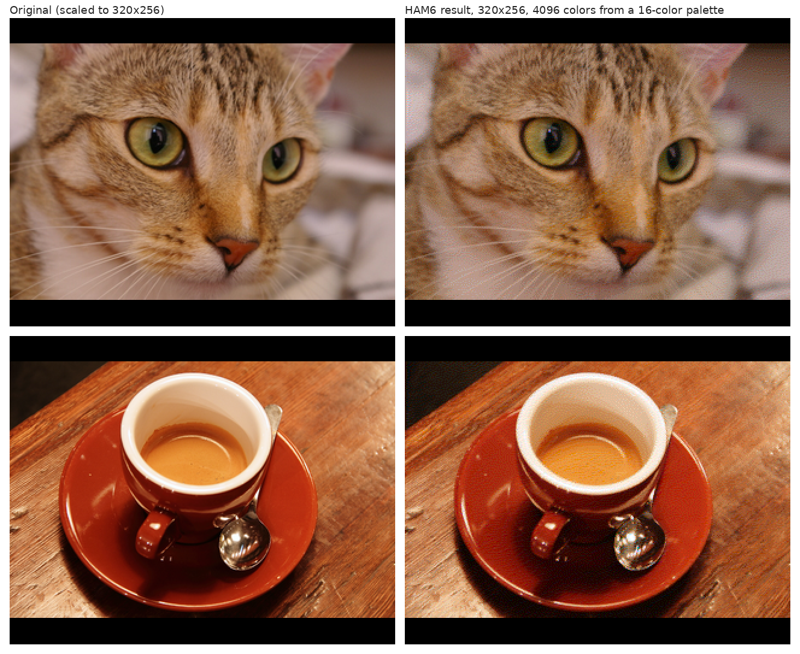
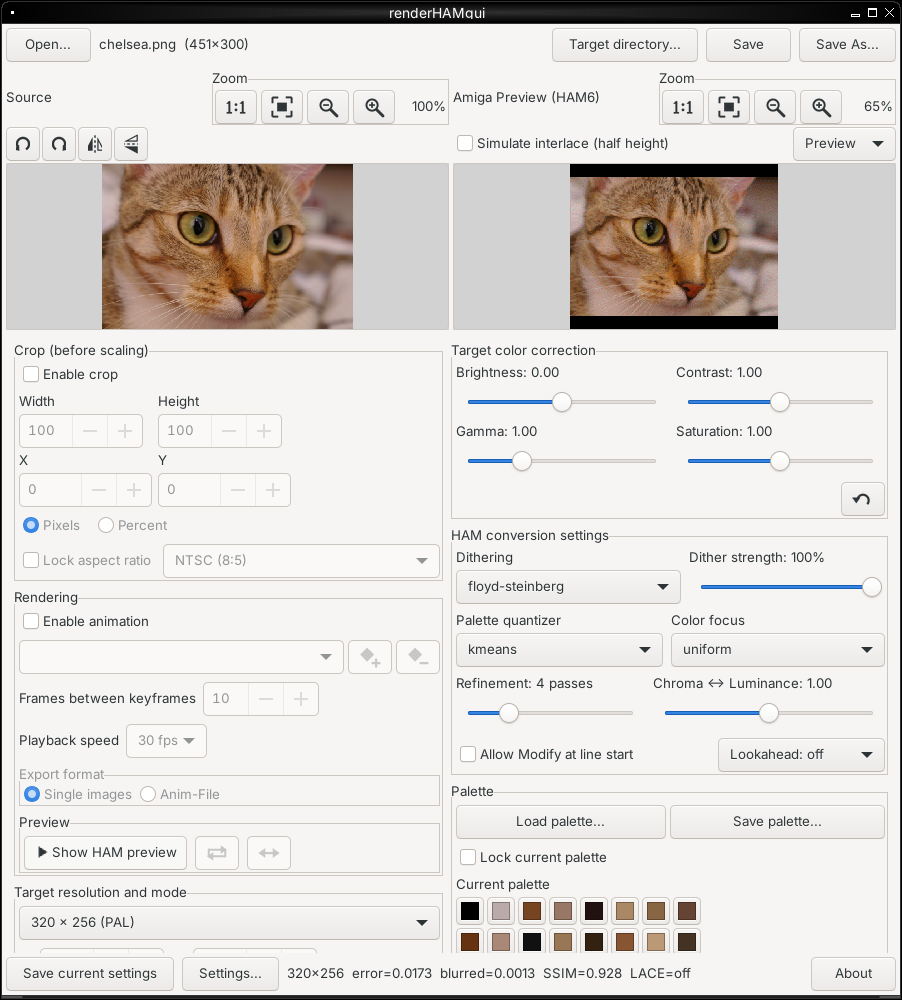

<!--
SPDX-License-Identifier: MIT
Copyright (c) 2026 rawbit (@ravvbit). AI-generated with Claude (Anthropic) under human direction; see this file.
-->

# renderHAM

**Turn photos into Amiga HAM6 pictures** – as real IFF/ILBM files, and as Ken Burns-style IFF animations.

> [!IMPORTANT]
> **This is AI-generated software.** All code, tests, scripts, translations and documentation in
> this repository were written by **Claude** (an AI model by Anthropic) in a long, interactive
> dialogue with a human, **rawbit** ([@ravvbit](https://github.com/ravvbit)), who set the requirements, ran the program, judged the
> results and decided what to keep. It is tested (see [Testing](#testing)), but it has had no
> independent human code review and no security audit. Read [AI-generated software](#ai-generated-software)
> before you rely on it.



*Two CC0 photos, converted with the default settings. Right: the HAM6 result at 320×256 pixels,
enlarged 2× for viewing.*

---

## 1. What is renderHAM?

### The short version

renderHAM takes an ordinary image (PNG, JPEG, BMP, TGA, GIF, PSD, PPM, PGM) and converts it to a file that an
Amiga computer can display natively: an **IFF ILBM picture in HAM6 mode**. If you give it
several crop windows over one image, it can also generate a smooth pan-and-zoom animation
(the "Ken Burns effect") as a series of pictures or as a single Amiga **IFF ANIM** file.

It comes as three parts that share the same code:

| Part | What it is |
|---|---|
| `renderHAM` | Command-line tool for single conversions and scripting |
| `renderHAMgui` | Desktop application (wxWidgets) with live source/result views, cropping, animation and a German translation |
| `renderhamlib` | The C++17 library underneath, usable from your own programs |

### What is HAM6?

A normal picture on the original Amiga chipset (OCS) is limited to a palette of at most 32 colors.
**HAM** ("Hold And Modify") mode gets around that. In HAM6 every pixel stores 6 bits: 2 control
bits and 4 data bits. Depending on the control bits a pixel either

* **selects** one of the 16 palette colors, or
* **modifies** the pixel to its left: it keeps that pixel's color but replaces exactly one of
  its red, green or blue components with the 4-bit value.

So the screen can show up to 4096 different colors although only 16 are in the palette – at the
price of a characteristic look: colors can only change by one component per pixel, so sharp
edges tend to smear or show colored fringes. Getting a *good* HAM picture is therefore an
optimization problem: which palette, and which of the 64 possible codes for every single pixel.

### How renderHAM solves it

renderHAM does not quantize first and dither afterwards. For each pixel, scanning every line from
left to right, it evaluates **all 64 reachable codes** (16 palette colors and 48 modifications of
the pixel to the left) against the target color and picks the best one – with the dithering
bias already applied to the target. Palette choice, dithering and HAM coding are one
decision, and all color distances are measured in **OKLab**, a perceptually uniform color space.

What you get:

* standard IFF ILBM files (optionally ByteRun1-compressed) with the HAM flag set,
* a PNG preview that shows exactly what the Amiga would display,
* quality figures that tell you how close the result is to the picture the encoder was given.

---

## 2. Features

### Conversion

* **Palette quantizers** (`--quantizer`): `kmeans` (default), `median-cut`, `octree`.
  The palette is then refined iteratively (`--palette-iterations`, default 4 passes).
* **Quality profiles** (`--profile`, the "Quality profile" choice in the GUI): three bundles of
  quantizer, refinement passes and lookahead, so that one choice trades time against quality –
  `fast`, `standard` (the default) and `best`; see the table below. Settings given on top of a profile
  win over it, and the GUI shows "Custom" when the three settings match none of them.
* **Color focus** (`--color-focus`): tell the palette optimizer which parts of the picture matter
  most – `uniform` (default), `center`, `edge`, `center-edge`, `golden-ratio`.
* **Chroma vs. luminance weight** (`--chroma-weight`): below 1 the encoder cares more about
  getting brightness right than getting the color right.
* **Dithering** (`--dither`, strength 0–100 %): error diffusion (`floyd-steinberg` (default),
  `atkinson`, `sierra-lite`, `jarvis-judice-ninke`) or ordered patterns (`bayer`, `blue-noise`,
  `checks`, `checks-lines`, `checks-lines-mixed`), or `none`.
* **Lookahead** (`--lookahead n`, off by default): a beam search that looks `n` pixels ahead when
  choosing a HAM operation. It starts a "modify" chain *before* an edge instead of after it,
  which reduces smearing – at roughly 6× the encoding time.
* **Palette control**: lock the current palette, load or save it as a standalone file – an IFF ILBM
  picture (`.iff`), a JASC palette (`.pal`, Paint Shop Pro) or a GIMP palette (`.gpl`) – and force
  palette entry 0 (the border color on real hardware) to a fixed color. The 16 colors of an Amiga
  palette are 4 bits per channel; they are scaled to 8 bits (×17) for the other two formats and
  back, so a palette survives the round trip unchanged. Foreign palettes with 16 entries load as
  well, rounded to the nearest of the 16 levels per channel.

#### The quality profiles in numbers

| Profile | Quantizer | Refinement passes | Lookahead | Error vs. `standard` | Time vs. `standard` |
|---|---|---|---|---|---|
| `fast` | `kmeans` | 1 | off | the same (photos ±0.0 %, others −1.9 … +0.3 %) | 0.73× (photos), 0.81× (others) |
| `standard` | `kmeans` | 4 | off | – | 1× (about 0.2 s at 320×256) |
| `best` | `kmeans` | 8 | 4 pixels | photos −4.8 % (−3.6 … −6.6 %), SSIM +0.006; others −0.9 % (−4.1 … +0.3 %) | about 7× |

Measured with the command line on four photographs and seven further test pictures (textures, a
test chart, …) at 320×256, Release build, wall time of the whole run including loading the picture,
best of three. The first refinement pass does nearly all the work of the later ones, which is why
`fast` costs nothing in quality; the lookahead is what makes `best` slow, and it pays off mostly on
photographs with soft edges – flat or regular pictures such as grass, gravel or coins gain
nothing. The error is the mean OKLab distance the converter prints. `renderHAM --list-profiles`
shows what each profile sets; a profile never touches dithering, size or color correction.

### Getting the picture into shape

* **Crop** before scaling, in pixels or percent (`--crop WxH+X+Y`, or a rubber band in the GUI).
* **Fit modes**: `fit` (letterbox), `fill` (crop to fill) or `stretch`; **pixel aspect** correction
  for the non-square pixels of Amiga display modes.
* **Rotate and mirror** the source; JPEG **EXIF orientation** is honored, and transparent areas of
  PNGs are blended over a background color of your choice.
* **Output-only color correction**: brightness, contrast, gamma, saturation.
* **Resolutions**: any size from 1×1 to 8192×8192; presets for PAL and NTSC, with and without
  overscan and interlace (for example 320×256 PAL, 352×280 PAL overscan, 320×200 NTSC,
  320×512 PAL interlaced). The interlace flag is set automatically from 400 lines up.

### Judging the result

After each conversion renderHAM reports three figures, all measured in OKLab between the
encoder's input picture and what HAM6 actually reproduces:

* **error** – mean color distance per pixel (strict: it penalizes every dithered pixel),
* **blurred** – the same after a Gaussian blur, closer to what eye and CRT make of neighboring
  pixels; this is the fair figure for comparing dithering methods,
* **SSIM** – structural similarity of the lightness (1 = identical); it notices lost edges and texture.

`--ham-map` and `--error-map` (and the `F6` key in the GUI) show *which* HAM operation each
pixel used and where the error is.

### Animation (GUI)

Tick **Enable animation**, give the crop box several **keyframes**, and renderHAM interpolates the
crop linearly between them – a pan, a zoom, or both. You choose the number of frames between
keyframes and the playback speed (frames per second). A **preview player** with loop and
ping-pong plays the sequence before you export it as

* numbered IFF pictures (`name_0001.iff`, `name_0002.iff`, …), or
* a single **IFF ANIM** file (ANIM-5, delta-compressed – the common Amiga format).

Frames are rendered in parallel, one worker thread per CPU core by default. With an ordered dither (`bayer`, `blue-noise`,
…) the dither pattern is, by default, attached to the *picture* instead of the screen, so a pan
does not make the pattern flicker (`--anchor-dither` gives the CLI the same behavior when you
render pan frames with `--crop` from a script).

### The GUI at a glance



* Source image on the left, HAM6 result on the right, always drawn with hard pixel edges. Zoom
  (`Ctrl+=`, `Ctrl+-`, `Ctrl+9` fit, `Ctrl+0` 100 %, `Ctrl`+wheel) and position (wheel, drag, scroll
  bars) are **linked** by default: both views show the same part of the picture at the same size,
  whatever the crop box, fit/fill/stretch and pixel aspect do to it. Untick *Link zoom and pan* to move
  them separately.
* The result view has four faces – preview, HAM map, error map and the **original** (what the encoder
  started from, before the 4096 colors). `F6` cycles them, `F7` flips between the original and the view
  you came from, at the same zoom and position, so before and after can be compared in place.
* **Auto preview** (the toggle next to *Show HAM preview*) converts again by itself a moment after a
  setting changes, after opening a picture and after rotating it. The newest request wins, so moving
  a slider never queues up conversions. It is off by default; `F5` always works.
* Open an image with the button, with drag and drop, or from the **Recent** list next to it (the last
  nine images; `Ctrl+Shift+O`, then a digit key). Readable formats: PNG, JPEG, BMP, TGA, GIF (first
  frame), Photoshop PSD (the flattened picture) and binary PPM/PGM.
* The **Quality profile** at the top of the HAM conversion settings sets the quantizer, the
  refinement passes and the lookahead below it in one go; changing one of those by hand makes it
  read "Custom". "Load palette..." and "Save palette..." handle IFF ILBM, JASC `.pal` and GIMP `.gpl`
  files; a saved name without an extension gets the one of the selected file type.
* Conversions run in the background with a progress display; `Esc` cancels.
* Settings can be saved as your defaults. The interface is in English by default; a German
  translation can be chosen in the Settings dialog or with `--lang de`.

| Shortcut | Action |
|---|---|
| `Ctrl+O` | Open an image |
| `Ctrl+Shift+O` | Open one of the recent images |
| `Ctrl+S` / `Ctrl+Shift+S` | Save to the target directory / save with a file picker |
| `F5` | Convert / play preview |
| `F6` | Cycle the result view: preview → HAM map → error map → original |
| `F7` | Original ↔ the view before |
| `Esc` | Cancel the running conversion or export |
| `Ctrl+L` / `Ctrl+R` | Rotate the source left / right |
| `Ctrl+Shift+H` / `Ctrl+Shift+V` | Mirror the source horizontally / vertically |
| `Ctrl+K` | Add keyframe |
| `Ctrl+Q` | Quit |

### The command line

```bash
renderHAM -i photo.jpg -o photo.iff
renderHAM -i photo.jpg -o photo.iff --dither bayer --fit fill --preview preview.png
renderHAM -i photo.jpg -o photo.iff --crop 50%x50%+25%+25% --width 352 --height 280 --lookahead 3
renderHAM --list-dithers          # also: --list-quantizers, --list-color-focus, --list-profiles
renderHAM --help
```

A conversion prints a summary line, for example
`wrote photo.iff (320x256, dither=floyd-steinberg, …, mean OKLab error=0.0173, blurred error=0.0013, SSIM=0.928)`.

The most useful options (see `--help` for all of them):

| Option | Meaning | Default |
|---|---|---|
| `-i`, `-o` | Source image, output IFF file | – |
| `--width`, `--height` | Target resolution, 1–8192 | 320 × 256 |
| `--fit` | `fit`, `fill` or `stretch` | `fit` |
| `--crop WxH+X+Y` | Crop before scaling; values in pixels or `%` | off |
| `--rotate`, `--flip-h`, `--flip-v` | Rotate clockwise by 0/90/180/270°, mirror | off |
| `--dither`, `--dither-strength` | Ditherer and its strength in % | `floyd-steinberg`, 100 |
| `--quantizer` | `kmeans`, `median-cut`, `octree` | `kmeans` |
| `--palette-iterations` | Palette refinement passes (0 = none) | 4 |
| `--color-focus`, `--chroma-weight` | Where and what the palette should favor | `uniform`, 1.0 |
| `--lookahead n` | Look `n` pixels ahead (0–8) | off |
| `--brightness`, `--contrast`, `--gamma`, `--saturation` | Output-only color correction | neutral |
| `--profile name` | `fast`, `standard` or `best`: a bundle of quantizer, refinement passes and lookahead (see below); the single options above override it | `standard` |
| `--load-palette`, `--save-palette`, `--fix-color0` | Palette control; the format follows the extension (`.iff`, `.pal`, `.gpl`) when saving and the content when loading | – |
| `--preview`, `--ham-map`, `--error-map` | Also write PNG previews/maps | – |
| `--no-compress`, `--lace`, `--no-lace` | Output file options | RLE on, lace automatic |

### Using the library

```cpp
#include <iostream>
#include "aic/aic.hpp"

int main() {
    aic::ConversionPipeline pipeline;
    aic::ConversionOptions opts;
    opts.target_width = 320;
    opts.target_height = 256;
    opts.ditherer_name = "floyd-steinberg";

    aic::ConversionResult r = pipeline.convert("photo.png", "photo.iff", opts);
    if (!r.success) { std::cerr << r.error_message << "\n"; return 1; }
    std::cout << "mean OKLab error " << r.mean_oklab_error << "\n";
}
```

The C++ namespace and include prefix are `aic` for historical reasons. Ditherers, quantizers and
color-focus maps register themselves at program start-up, so an executable must link the static
library with every object file included; `cmake/AicWholeArchive.cmake` provides
`aic_link_whole_archive(<target> renderhamlib)` for that. The library API is not stable yet (see
[Versioning](#versioning)). `aic::canvas_mapping()` (`aic/canvas_mapping.hpp`) gives the position of a
source point on the converted canvas and back, for crop box, fit/fill/stretch and pixel aspect – what
a viewer needs to show source and result in step.

### Good to know

* Only classic full-picture **HAM6** is produced – no HAM8, Sliced HAM or Dynamic HiRes.
* The files are standard IFF ILBM, but **no test on real Amiga hardware or in an Amiga emulator
  is documented yet**. The output is verified with an independent decoder and with netpbm's
  `ilbmtoppm` (see [Testing](#testing)).
* There is no batch mode. The preview is made when you press *Convert* (`F5`) or, with the *Auto preview*
  toggle on, a moment after a setting changed – not continuously while a slider moves.
* The animation features are part of the GUI; the command line converts single pictures.

---

## 3. Building and installing

### Requirements

* A C++17 compiler (GCC, Clang) and **CMake 3.16 or newer**
* For the GUI (optional): **wxWidgets 3.0 or newer** (developed with 3.2; the workflow also builds it with 3.0.5, the version of Ubuntu 22.04)
* For the German GUI translation (optional): GNU gettext (`msgfmt`)

The command-line tool and the library need nothing else – the image loading, writing and
scaling libraries (stb) are included in `third_party/`, and the build needs no network access.

On Debian, Ubuntu and Linux Mint:

```bash
sudo apt install build-essential cmake libwxgtk3.2-dev gettext
```

(`libwxgtk3.0-gtk3-dev` on Ubuntu 22.04 and Linux Mint 21, which have no wxWidgets 3.2.)

### Build

```bash
git clone https://github.com/ravvbit/renderham.git
cd renderham
cmake -S . -B build -DCMAKE_BUILD_TYPE=Release
cmake --build build -j
```

This produces `build/tools/renderham/renderHAM`, `build/tools/renderhamgui/renderHAMgui` and
`build/renderhamlib/librenderhamlib.a`. If wxWidgets is not found, the GUI is skipped and
everything else is built; `-DAIC_BUILD_GUI=OFF` skips it on purpose. Without gettext the GUI
is English only.

Try it:

```bash
./build/tools/renderham/renderHAM -i testdata/test_input.png -o /tmp/test.iff --preview /tmp/test.png
./build/tools/renderhamgui/renderHAMgui testdata/test_input.png
```

### Testing

```bash
cd build && ctest --output-on-failure
```

Twelve test programs cover the encoder and its lookahead, input validation, EXIF/alpha handling,
animation sequences and timing, dither anchoring, the quality figures (the latter against
values computed independently with NumPy), the readable image formats, the palette file formats,
the quality profiles, the map from source to canvas that keeps the GUI's two views in step
(checked against where the pipeline really puts a marker) and file names with non-ASCII characters
(umlauts, accents, Japanese) in every place that opens a file. Beyond ctest, the Python tools in `testdata/` check
the output files: `verify_ilbm.py` parses an IFF file independently of the C++ code, and
`decode_ham6_independent.py` is a from-scratch HAM6 decoder whose result is compared pixel by
pixel with the tool's own preview. `scripts/ham_eval.py` compares settings objectively
(it needs NumPy and Pillow).

### Install

```bash
sudo cmake --install build --prefix /usr/local
```

installs the two programs (the GUI translation is placed next to the GUI executable, where it
looks for it), the library and its headers.

### Packages

`.github/workflows/build.yml` builds and tests renderHAM on GitHub and packages it for x86_64
Linux (three formats), for Windows (a ZIP file) and for macOS (a disk image). Every push to `main`
and every pull request produces the packages as workflow artifacts; pushing a version tag
(`v0.2.0`, ...) also drafts a GitHub release with all of them and a `SHA256SUMS` list. You can
build each one yourself as well. Linux first, then [Windows and macOS](#windows-and-macos).

#### Linux

The Debian package and the AppImage are built on **Ubuntu 22.04** (in a container on the GitHub
runner), so that they run on Linux Mint 21 and everything newer: a program needs a C library at
least as new as the one it was built with, and Ubuntu 22.04 has the oldest one of the systems
this is meant for (glibc 2.35). Ubuntu 22.04 only has wxWidgets 3.0, so the two packages contain
wxWidgets 3.2, linked statically (`scripts/build_wx_linux.sh` builds it; the workflow caches the
result). The workflow installs both packages on clean Ubuntu 22.04, Ubuntu 24.04 and Debian 12
systems and starts the GUI there.

**Debian package** (command-line tool and GUI; for Ubuntu 22.04 and newer, Linux Mint 21 and
newer, Debian 12 and newer):

```bash
# On a system with wxWidgets 3.2 (Ubuntu 24.04, Debian 12 and newer): libwxgtk3.2-dev is enough.
sudo apt install build-essential cmake gettext libwxgtk3.2-dev dpkg-dev   # help2man and lintian are used if present
DEB_MAINTAINER="Your Name <you@example.org>" ./scripts/build_deb.sh

# On Ubuntu 22.04 / Linux Mint 21 (no wxWidgets 3.2 there): build it first, statically.
sudo apt install build-essential cmake gettext pkg-config libgtk-3-dev libsm-dev libxtst-dev curl bzip2 dpkg-dev
./scripts/build_wx_linux.sh              # into build-wx/prefix
WX_CONFIG="$PWD/build-wx/prefix/bin/wx-config" DEB_MAINTAINER="Your Name <you@example.org>" ./scripts/build_deb.sh

sudo apt install ./dist/renderham_*.deb
```

The script builds the project, works out the run-time dependencies with `dpkg-shlibdeps`,
generates man pages and writes the package to `dist/`. The package version is the one
defined in `CMakeLists.txt`. The package also installs a menu entry and an icon. A package built
against a system's own wxWidgets depends on that system's wxWidgets package, so it only installs on
that release and newer.

**AppImage** (the GUI as one file that runs without installation; needs glibc 2.35 or newer):

```bash
sudo apt install build-essential cmake gettext pkg-config libgtk-3-dev libsm-dev libxtst-dev librsvg2-dev curl file desktop-file-utils bzip2
./scripts/build_wx_linux.sh              # wxWidgets 3.2, static, into build-wx/prefix
WX_CONFIG="$PWD/build-wx/prefix/bin/wx-config" ./scripts/build_appimage.sh
chmod +x dist/renderHAM-*-x86_64.AppImage && ./dist/renderHAM-*-x86_64.AppImage
```

The script downloads linuxdeploy and appimagetool (checked against pinned SHA-256 sums) and
bundles the GTK stack into the image. An AppImage needs a C library at least as new as the one
it was built with, so build it on the oldest system you want to support: the published one is built
on Ubuntu 22.04 and runs on distributions with glibc 2.35 or newer. The command-line tool is not
part of the AppImage.

**Flatpak** (the GUI and the command-line tool, sandboxed; builds wxWidgets from source on the
GNOME runtime, which takes a while):

```bash
flatpak install flathub org.gnome.Platform//50 org.gnome.Sdk//50
flatpak-builder --user --install --force-clean build-dir packaging/linux/flatpak/io.github.ravvbit.renderham.yml
flatpak run io.github.ravvbit.renderham
flatpak run --command=renderHAM io.github.ravvbit.renderham --help
```

The desktop entry, the AppStream metadata and the (placeholder) icon live in `packaging/linux/`;
all three packages use them.

### Windows and macOS

#### Downloads

The release page (and, for every build, the workflow run) has

* `renderHAM-<version>-windows-x64.zip`: unpack it anywhere and double-click `renderHAMgui.exe`.
  The folder holds the GUI, the command-line tool `renderHAM.exe`, the DLLs they need and the German
  translation; keep it together. Needs Windows 10 or newer, 64 bit.
* `renderHAM-<version>-macos-universal.dmg`: open it and drag `renderHAM.app` onto *Applications*. One
  program for Intel Macs and for Apple Silicon, macOS 11 or newer. The command-line tool is in the
  folder *Command-line tool* of the disk image.

Neither program is signed. Windows may warn about an unknown publisher (SmartScreen: "More info",
then "Run anyway"), and macOS refuses to open the app by double-click the first time (System Settings
> Privacy & Security > "Open Anyway"). A `README.txt` with these steps is in both packages.

#### What the automated checks cover

On every push and pull request the workflow builds the library, the command-line tool and the GUI and
runs the whole test suite on **Windows** (MinGW-w64 from MSYS2, UCRT64) and on **macOS**. For both it
then unpacks the finished package like a user would, runs `renderHAM --version`, converts a picture
to a file with a non-ASCII name, starts the GUI with a picture and checks that it is still running
a few seconds later; the screenshots it takes are kept as workflow artifacts. On Windows the GUI
also converts the picture (`F5`) before the screenshot.

What that does **not** cover: the macOS program is one universal build, but the macOS test machine
is an Intel Mac, so the Apple Silicon half of it is compiled and linked but never run (GitHub
did not hand out an Apple Silicon runner when this was set up). Nobody but the CI has used these
packages yet, so expect rough edges; bug reports are welcome.

What the code does for those systems: file names with non-ASCII characters work (the library takes
UTF-8 paths and hands Windows what it expects; the command-line tool reads its arguments as UTF-16
there); renderHAMgui is a windowed program without a console window on Windows (with an icon, a
manifest for the modern look and per-monitor DPI) and an application bundle (`renderHAM.app`, with
`Info.plist`, the icon and the translation inside) on macOS.

#### Building the packages yourself

* **Windows:** install [MSYS2](https://www.msys2.org), open its *UCRT64* shell and run
  `pacman -S zip mingw-w64-ucrt-x86_64-{gcc,cmake,ninja,gettext-tools,wxwidgets3.2-msw}`, then
  `cmake -S . -B build -G Ninja && cmake --build build && ctest --test-dir build` and
  `./scripts/package_windows.sh build dist`. The script copies the programs, the translation, the
  license of renderHAM and every DLL they need (found by reading the import tables) into
  `dist/renderHAM-<version>-windows-x64/`, adds the license files of the MSYS2 packages the DLLs come
  from (`licenses/`, with `PACKAGES.txt` saying which package, version and license each DLL has; the script
  stops if one is missing) and zips that folder. Without the script, the programs
  need the DLLs from MSYS2's `ucrt64/bin` folder (the UCRT64 shell has it on its `PATH`).
  The MinGW-w64 compiler has to use the *posix* thread model (MSYS2's does), because the animation
  renderer uses `std::thread`.
* **macOS:** install Xcode's command-line tools, CMake, Ninja and gettext (for example with
  Homebrew) and build wxWidgets 3.2 as a static library; the workflow does that from the source
  archive (`macos` job, step "Build wxWidgets") with `--enable-universal_binary=x86_64,arm64`, and
  caches the result, because Homebrew has no wxWidgets 3.2 package for Intel Macs. Then configure
  with `-DwxWidgets_CONFIG_EXECUTABLE=<prefix>/bin/wx-config` (and
  `-DCMAKE_OSX_ARCHITECTURES="x86_64;arm64"` for a universal build), build as usual and run
  `./scripts/package_macos.sh build dist`. The application bundle is
  `build/tools/renderhamgui/renderHAM.app`; the script signs it ad hoc (no developer
  certificate) and writes `dist/renderHAM-<version>-macos-universal.dmg`. With a static wxWidgets
  the bundle needs no libraries beyond the ones macOS has, which the script checks. It also puts the
  license texts of wxWidgets (and of the libraries bundled with it) into the bundle; they come from
  the folder `WX_LICENCE_DIR` (default: `share/doc/wxWidgets` of the wxWidgets prefix), which
  `scripts/install_wx_licences.sh <wxWidgets source dir> <folder>` fills from the source archive
  (`build_wx_linux.sh` does it for the Linux build; the macOS job of the workflow does it, too).

The icon files (`packaging/windows/renderham.ico`, `packaging/macos/renderham.icns`) are made from the
Linux icon by `scripts/make_app_icons.py` (needs `rsvg-convert`); they are committed, so building
does not need the tool.

### Translating the GUI

`scripts/update_translations.sh` extracts the strings from the source and merges them into
`tools/renderhamgui/po/*.po`. To add a language, add its `.po` file and its code to
`AIC_GUI_LOCALES` in `tools/renderhamgui/CMakeLists.txt`.

---

## Project layout

```
renderhamlib/        the library: encoder, quantizers, ditherers, IFF writers, pipeline
  include/aic/       public headers
  src/               implementation
tools/renderham/     command-line tool
tools/renderhamgui/  wxWidgets GUI (with po/ translations)
tests/               ctest programs
testdata/            small synthetic test pictures and independent verification scripts
scripts/             Debian, AppImage, Windows and macOS packaging, static wxWidgets for Linux, icon generators, evaluation and translation helpers
packaging/linux/     desktop entry, AppStream metadata, icon and the Flatpak manifest
packaging/windows/   icon, manifest and resource file of renderHAMgui.exe, README.txt of the ZIP file
packaging/macos/     icon, Info.plist of the application bundle, README.txt of the disk image
.github/workflows/   GitHub Actions: build, test and package for Linux, Windows and macOS (build.yml)
third_party/stb/     vendored single-file libraries
cmake/               CMake helper for the self-registering components
docs/                images for this README
```

## Versioning

renderHAM uses [Semantic Versioning](https://semver.org). The version is defined once, in the
`project()` call of the top-level `CMakeLists.txt`, and flows from there into
`renderHAM --version`, the GUI's About dialog and the Debian package. The library, the command
line tool and the GUI share one version number. Releases are tagged `vMAJOR.MINOR.PATCH`;
[`CHANGELOG.md`](CHANGELOG.md) lists what changed. To release: bump the version, add a
`<release>` entry to `packaging/linux/io.github.ravvbit.renderham.metainfo.xml` and a section to
the changelog, then push the tag; the workflow checks that all of them agree.

The current series is **0.x**: the program is usable, but command-line options, the GUI's
saved settings and the C++ API may still change between minor versions. Version 1.0.0 will
mark the point where they settle.

## AI-generated software

This project was built by an AI model working with a human:

* **Who wrote what.** Claude (Anthropic) wrote the code, the tests, the build scripts, the
  documentation and the German translation. **rawbit** ([@ravvbit](https://github.com/ravvbit)) specified what the software should do,
  ran it, looked at the results, reported problems and decided about every change.
* **What that means for you.** Treat the code like any software you did not write yourself:
  look before you trust. It is covered by automated tests and by independent verification of
  its output files, but it has not been reviewed line by line by an independent human, and it
  has not been audited for security. Be careful with untrusted input files.
* **Where it is marked.** This README, a header in every source file of its own, `renderHAM --version`,
  the GUI's About dialog, the Debian package description and the commit messages
  (`Co-Authored-By: Claude`) all say so.
* **Copyright.** In many jurisdictions purely machine-generated material is not protected by
  copyright, while a human's creative direction, selection and editing can be. The license below
  applies to every right that exists in this work; the copyright notice names the human who
  directed it. This is not legal advice.

## License

renderHAM is released under the **[MIT License](LICENSE)** – use it, change it, ship it,
including in commercial and closed-source products, as long as the copyright and license notice
stay with it. There is no warranty.

Third-party components and their licenses are listed in
[`THIRD_PARTY_NOTICES.md`](THIRD_PARTY_NOTICES.md). In short: the bundled stb libraries are
MIT/public domain, and wxWidgets (used only by the GUI, installed separately) is under the
wxWindows Library Licence, which explicitly allows programs under other licenses to link it.
The two example photos in `docs/images/example.png` (and the cat photo in the GUI screenshot
`docs/images/gui.png`) are sample images from scikit-image, released as CC0 by their photographers:
the cat photo by Stefan van der Walt, the coffee photo by Rachel Michetti (courtesy of Pikolo
Espresso Bar). See the [scikit-image data documentation](https://scikit-image.org/docs/stable/api/skimage.data.html).

"Amiga", "Deluxe Paint" and other product names are trademarks of their respective owners.
renderHAM is an independent project and is not affiliated with or endorsed by them.
